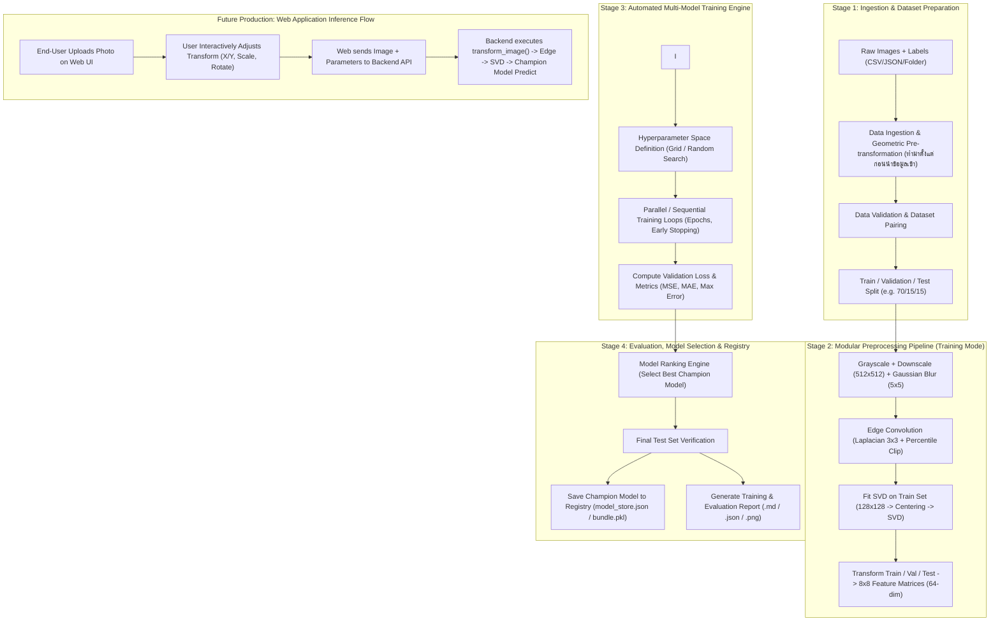

# สถาปัตยกรรมการรวม Preprocessing และ MLP เข้าสู่ระบบ Automated Training & Best Model Selection

เอกสารฉบับนี้ออกแบบระบบ **End-to-End Automated Training Pipeline** สำหรับโปรเจกต์ตรวจนับกล่องพัสดุ (Parcel Box Counter) โดยรวมกระบวนการ **Image Preprocessing**, **SVD Feature Extraction**, **Automated Multi-Configuration Training (Hyperparameter Search / Cross-Validation)** และ **Best Model Selection & Deployment** เข้าด้วยกันอย่างเป็นระบบและอัตโนมัติ 100%

---

## 1. วัตถุประสงค์และภาพรวมระบบ (System Objectives & Architecture)

### 1.1 วัตถุประสงค์
1. **End-to-End Integration**: เชื่อมต่อ Data Ingestion & Preprocessing เข้ากับ MLP Training โดยไม่ต้องรันสคริปต์แยกส่วนด้วยตนเอง
2. **Automated Search & Training**: สามารถสำรวจ Hyperparameters (Learning Rate, k, Architecture, Preprocessing parameters) อัตโนมัติ
3. **Data Splitting & Cross Validation**: รองรับ Train / Validation / Test Split เพื่อประเมินผลลัพธ์ที่แท้จริง ป้องกัน Data Leakage และ Overfitting
4. **Automated Best Model Selection**: เปรียบเทียบโมเดลในแต่ละ Configuration ตาม Metric ที่กำหนด (เช่น Validation MSE, MAE, R²) และคัดเลือกโมเดลที่ดีที่สุด (Champion Model) อัตโนมัติ
5. **Model Registry & Artifact Persistence**: จัดเก็บโมเดลที่ดีที่สุดทั้ง Parameters, SVD Projection Matrix, Preprocessing Config และ Evaluation Report พร้อมนำไปใช้งานต่อทันที

---

### 1.2 สถาปัตยกรรมระบบรวม (End-to-End Automated Pipeline Flow)



---

## 2. โครงสร้างโฟลเดอร์และไฟล์ใหม่ที่ออกแบบ (Target Project Layout)

เพื่อรองรับระบบอัตโนมัติที่มีระเบียบ ขยายต่อได้ง่าย และไม่ผูกติดกับการเขียนโค้ดซ้ำซ้อน:

```
parcel-box-counter/
├── documents/
│   ├── model_training_pipeline.md        # รายละเอียด Pipeline ปัจจุบัน
│   └── auto_training_pipeline_design.md  # เอกสารการออกแบบฉบับนี้
├── model/
│   ├── preprocessing/                     # Modular Preprocessing ที่แยกไว้แล้ว
│   │   ├── config.py
│   │   ├── data_ingestion.py
│   │   ├── geometric_transform.py
│   │   ├── edge_processing.py
│   │   ├── svd_features.py
│   │   ├── image_pipeline.py
│   │   └── run_preprocessing.py
│   ├── mlp/                               # Core Regression Model
│   │   ├── mlp_regression.py
│   │   └── model_store.json
│   ├── training/                          # [NEW] โมดูล Automated Training & Evaluation
│   │   ├── __init__.py
│   │   ├── dataset.py                     # จัดการจับคู่ภาพกับ Label และทำ Data Split
│   │   ├── trainer.py                     # Training Loop, Early Stopping, Validation
│   │   ├── tuner.py                       # Search Space & Trial Execution
│   │   ├── evaluator.py                   # Metrics calculation (MSE, MAE, R2, Accuracy within ±1)
│   │   └── model_registry.py              # จัดการบันทึก/โหลด Champion Model
│   └── run_auto_train.py                  # [NEW] Main Entry Point สั่งรันทั้งระบบด้วยคำสั่งเดียว
└── artifacts/                             # [NEW] ที่เก็บผลการทดลองและโมเดลที่ดีที่สุด
    ├── trials/                            # บันทึก log และ weights ของแต่ละ trial
    └── best_model/                        # เก็บ Best Model Bundle พร้อมใช้งาน
        ├── svd_model.npz                  # Projection matrix ของ Best Model
        ├── best_weights.json              # W, b, k, architecture
        ├── pipeline_config.json           # ค่า config ของ preprocessing
        └── evaluation_report.json         # ผลทดสอบบน Test Set
```

---

## 3. รายละเอียดการทำงานของแต่ละส่วนประกอบ (Component Specifications)

### 3.1 Dataset Preparation & Splitting ([dataset.py](file:///c:/Users/DELL/Downloads/CNNs/parcel-box-counter/model/training/dataset.py))
* **Input**: พาธรูปภาพ และไฟล์ระบุจำนวนกล่องจริง (Label) เช่น `labels.csv` หรือ parsing จากชื่อไฟล์/โฟลเดอร์
* **หน้าที่**:
  1. จับคู่รูปภาพต้นฉบับกับ Label `y` (จำนวนกล่องพัสดุ)
  2. แบ่งข้อมูลออกเป็น 3 ชุด:
     * **Train Set (70%)**: ใช้ Fit SVD และ Optimize Weights ของ MLP
     * **Validation Set (15%)**: ใช้ปรับจูน Hyperparameters, ตรวจสอบ Early Stopping และ Ranking โมเดล
     * **Test Set (15%)**: ข้อมูลที่ไม่เคยเห็นมาก่อน (Unseen) สำหรับการประเมินรอบสุดท้าย
  * *ข้อควรระวังสำคัญ (Data Leakage Prevention)*: กระบวนการ Fit Mean และ Singular Vectors ของ SVD ต้องกระทำ**เฉพาะบน Train Set เท่านั้น** จากนั้นจึงนำ Matrix $V^T$ มา Project ข้อมูล Validation และ Test Set

---

### 3.2 Preprocessing Integration Wrapper (Training vs Web App Production)

การเชื่อมต่อฟังก์ชันจาก `model/preprocessing/` เข้าสู่ระบบแบ่งออกเป็น 2 โหมดการทำงานที่ชัดเจน:

#### ก. โหมดการเทรนโมเดล (Automated Training Mode):
* **ข้ามขั้นตอน Geometric Transform**: ในการเทรนจริงระบบจะไม่นำภาพไปหมุนหรือเลื่อนพิกเซลด้วยสูตรคงที่ เพราะรูปภาพแต่ละรูปมีความเอียง แสง และระยะห่างไม่เหมือนกัน งานการจัดเฟรม (Alignment & Cropping) เป็นหน้าที่ของ**ผู้นำเข้าและเตรียมข้อมูล (Data Ingestor / Ingestion Specialist)**
* **ลำดับขั้นตอนใน Training Pipeline**:
  ```python
  # 1. รับรูปภาพที่ผ่านการตรวจสอบและจัดตำแหน่งแล้วจากผู้นำเข้าข้อมูล (bgr)
  # 2. ข้าม transform_image() -> ส่งตรงเข้า to_grayscale()
  # 3. Resize (512x512) -> Gaussian Blur (5x5) -> Laplacian Edge Map (Percentile Clip 98%)
  # 4. SVD Feature Extraction (เฉพาะ Train set ทำการ Fit SVD -> Mean_train, Vt_train)
  # 5. Project ข้อมูล Train / Val / Test ด้วย Mean_train และ Vt_train -> ได้ Feature Matrix 8x8 (64 มิติ)
  ```

#### ข. โหมดการใช้งานจริงบนเว็บแอปพลิเคชัน (Web App Production Inference Mode):
* โมดูล `geometric_transform.py` จะถูกนำไปใช้งานจริงบน **Web Application Interface**:
  1. **User Image Ingestion**: End-User ทำการถ่ายรูปหรืออัปโหลดรูปภาพกล่องพัสดุผ่านเบราว์เซอร์
  2. **Interactive Transformation UI**: หน้าเว็บจะมี Interactive Slider / Canvas Controller ให้ผู้ใช้สามารถเลื่อนภาพ (Translate X/Y), ซูมเข้า/ออก (Scale), หรือหมุนภาพ (Rotate) เพื่อให้มุมมองของกล่องพัสดุเข้ากรอบสี่เหลี่ยมอ้างอิงอย่างพอดี
  3. **Payload Dispatch**: เว็บจะส่งข้อมูลภาพ พร้อมค่าพารามิเตอร์ที่ผู้ใช้กำหนด `(translate_x, translate_y, scale_factor, rotation_deg)` ไปยัง Backend API
  4. **Prediction Pipeline**: Backend จะประมวลผลตามลำดับ:
     $$\text{Raw Image} \xrightarrow{\text{transform\_image(params)}} \text{Adjusted Image} \xrightarrow{\text{Edge Processing}} \text{Edge Map} \xrightarrow{\text{SVD Project}} Z \xrightarrow{\text{Champion Model}} \hat{y} \text{ (จำนวนกล่อง)}$$

---

### 3.3 Automated Training & Search Engine ([tuner.py](file:///c:/Users/DELL/Downloads/CNNs/parcel-box-counter/model/training/tuner.py) & [trainer.py](file:///c:/Users/DELL/Downloads/CNNs/parcel-box-counter/model/training/trainer.py))

ระบบจะรันการทดลองหลาย Configuration อัตโนมัติ (Automated Hyperparameter Grid / Random Search):

#### พารามิเตอร์ที่สำรวจ (Search Space Example):
| Parameter Group | Hyperparameter | ช่วงค่าที่ทดสอบ (Candidates) |
|---|---|---|
| **Preprocessing** | `blur_ksize` | `[3, 5, 7]` |
| | `clip_percentile` | `[95.0, 98.0, 99.0]` |
| | `n_svd_features` | `[64]` (Flattened 8×8 Matrix) |
| **Model & Optimizer** | `learning_rate` | `[0.001, 0.005, 0.01, 0.05, 0.1]` |
| | `k` (Scaled Sigmoid Max) | `[10.0, 15.0, 20.0]` (ขึ้นกับจำนวนกล่องสูงสุดที่คาดหวัง) |
| | `epochs` | `[100, 300, 500]` (พร้อม Early Stopping) |
| | `batch_size` | `[4, 8, 16, 32]` หรือ Full Batch |
| | `weight_init` | `["zeros", "gaussian_0.01", "xavier"]` |

#### กลไก Early Stopping & Checkpointing:
* ในแต่ละ Trial จะติดตามค่า **Validation Loss (MSE)** ทุกๆ Epoch
* หาก Validation Loss ไม่ลดลงต่อเนื่องเกิน `patience` (เช่น 15 epochs) ระบบจะหยุดเทรน Trial นั้นทันทีเพื่อประหยัดเวลา
* บันทึก Weights ที่จุดที่ได้ Validation Loss ต่ำที่สุดของ Trial นั้น (Best Epoch Weights)

---

### 3.4 เกณฑ์การคัดเลือกโมเดลที่ดีที่สุด (Best Model Selection Criteria)

ใน [evaluator.py](file:///c:/Users/DELL/Downloads/CNNs/parcel-box-counter/model/training/evaluator.py) ระบบจะจัดอันดับโมเดลทั้งหมดที่เทรนเสร็จด้วยเกณฑ์ Multi-Metric ดังนี้:

1. **เกณฑ์หลัก (Primary Metric)**:
   $$\text{Validation MSE} = \frac{1}{M} \sum_{i=1}^M (\hat{y}_i - y_i)^2 \quad \text{(ค่าน้อยที่สุดชนะ)}$$
2. **เกณฑ์รอง (Secondary Metrics)**:
   * **Mean Absolute Error (MAE)**: ดูค่าเฉลี่ยความคลาดเคลื่อนจริงของจำนวนกล่อง (เช่น คลาดเคลื่อนเฉลี่ยไม่เกิน 0.35 กล่อง)
   * **Exact / Near Accuracy**: ร้อยละของตัวอย่างที่ทำนายปัดเศษแล้วตรงกับ Ground Truth ($|\text{round}(\hat{y}) - y| \le 0$) หรือคลาดเคลื่อนไม่เกิน 1 กล่อง ($|\hat{y} - y| \le 1.0$)
   * **Generalization Gap**: ตรวจสอบ $|\text{Train Loss} - \text{Val Loss}|$ เพื่อคัดกรองโมเดลที่เกิด Overfitting สูงออกไป

---

### 3.5 Model Registry & Deployment Packaging ([model_registry.py](file:///c:/Users/DELL/Downloads/CNNs/parcel-box-counter/model/training/model_registry.py))

เมื่อได้ Champion Model ระบบจะทำการ:
1. **ประเมินบน Test Set (Unseen Data)** ครั้งสุดท้าย และบันทึกผลเป็น Test Score จริง
2. **รวมแพ็กเกจโมเดล (Self-Contained Model Bundle)**:
   * `model_store.json`: บันทึก $W$, $b$, $k$, learning rate และเวอร์ชัน
   * `svd_model.npz`: เก็บ `mean`, $V^T$ สำหรับนำไปใช้แปลงภาพใหม่
   * `manifest.json`: บันทึก Metadata เช่น วันที่เทรน, Validation Loss, Test MAE, Hyperparameters ที่ดีที่สุด
3. **จัดเก็บบันทึกประวัติการแข่งขัน (Leaderboard)**:
   * บันทึกตารางสรุปผลทุก Trials ลง `artifacts/leaderboard.csv` เพื่อให้ตรวจสอบย้อนหลังได้

---

## 4. ตัวอย่างคำสั่งการใช้งาน (User CLI Experience)

ผู้ใช้สามารถสั่งรันทั้งระบบได้ด้วยคำสั่งเดียวผ่าน [run_auto_train.py](file:///c:/Users/DELL/Downloads/CNNs/parcel-box-counter/model/run_auto_train.py):

```bash
# รันโหมดค้นหาอัตโนมัติ (Auto Grid Search) พร้อมกำหนดข้อมูล Label
python model/run_auto_train.py \
    --images-dir dataset/boxes \
    --labels dataset/labels.csv \
    --search-strategy grid \
    --epochs 300 \
    --patience 15 \
    --metric val_loss \
    --export-best artifacts/best_model
```

### ตัวอย่าง Output ที่ระบบจะแสดงบนหน้าจอ:

```
======================================================================
  PARCEL BOX COUNTER — AUTOMATED TRAINING & MODEL SELECTION
======================================================================
[Stage 1] Loading data & splitting...
  Found 120 images with labels.
  Split: Train=84, Val=18, Test=18

[Stage 2] Running Preprocessing & SVD on Train Set...
  SVD fitted successfully (Output feature dim: 64)

[Stage 3] Hyperparameter Search (Total 12 Trials)...
  Trial 01/12 | LR=0.010, k=10, blur=5 | Val MSE: 0.2415 | Val MAE: 0.38
  Trial 02/12 | LR=0.005, k=10, blur=5 | Val MSE: 0.1820 | Val MAE: 0.31
  Trial 03/12 | LR=0.001, k=10, blur=5 | Val MSE: 0.3540 | Val MAE: 0.49
  ...
  Trial 12/12 | LR=0.020, k=12, blur=5 | Val MSE: 0.1250 | Val MAE: 0.24 (New Best!)

======================================================================
  SELECTION SUMMARY & TEST SET VERIFICATION
======================================================================
🏆 Champion Model: Trial 12
  - Hyperparameters: LR=0.02, k=12.0, Blur=5x5, Clip=98%
  - Validation MSE : 0.1250 (MAE: 0.24 กล่อง)
  - Final Test MSE : 0.1310 (MAE: 0.25 กล่อง)
  - Accuracy (±1)  : 94.4%

✓ Exported Champion Model bundle to: artifacts/best_model/
  - model_store.json
  - svd_model.npz
  - pipeline_config.json
  - training_report.md
======================================================================
```

---

## 5. ลำดับขั้นตอนการ Implement ในโค้ดจริง (Implementation Roadmap)

1. **Step 1: Dataset & Labels Loader**
   * สร้าง `model/training/dataset.py` ให้รองรับการอ่าน Label จากไฟล์ CSV / JSON หรือ Mapping จากชื่อไฟล์รูปภาพ พร้อมฟังก์ชันแบ่ง Train / Val / Test
2. **Step 2: Training & Validation Runner**
   * ปรับปรุงฟังก์ชัน `train_step` ใน `mlp_regression.py` ให้รับ Batch และ Validation evaluation ได้อย่างยืดหยุ่นใน `model/training/trainer.py`
3. **Step 3: Search Engine & Trial Runner**
   * เขียน `model/training/tuner.py` สำหรับวนลูปทดสอบค่าพารามิเตอร์แต่ละคู่ พร้อมระบบบันทึกประวัติ Loss
4. **Step 4: Model Selection & Auto-Exporter**
   * เขียน `model/training/model_registry.py` คัดเลือกโมเดลที่ Loss ต่ำสุด แล้วบันทึกไฟล์ Bundle พร้อมใช้งาน
5. **Step 5: Master CLI Script**
   * เชื่อมโยงทุกขั้นตอนเข้ากับ `model/run_auto_train.py` ให้เรียกใช้งานผ่าน CLI ได้สะดวกทั้งบนเครื่อง Local และ Google Colab
